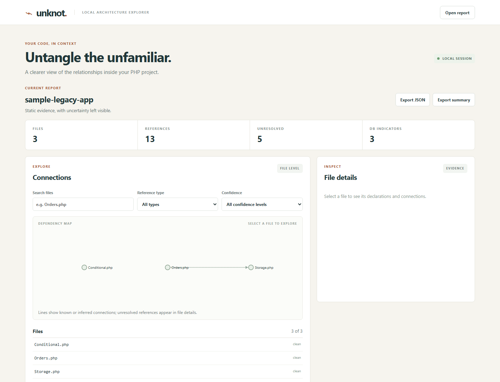

# Unknot

Unknot is a local PHP architecture explorer. Its first command scans a directory without running the scanned application and writes a JSON report of file declarations and a small set of static references.



## Foundation prototype

The prototype has been tested with PHP 8.1, which is no longer supported upstream. Use an isolated local environment; migration to a supported runtime remains planned. Install dependencies with Composer and run the included synthetic fixture:

```sh
composer install
php bin/unknot scan fixtures/sample-legacy-app --output=report.json
php bin/unknot serve --report=report.json
composer test
```

Open `legacy-viewer/index.html` in a browser and choose the generated JSON report. Search filenames, declarations or available method names, filter by directory, follow a reference, and keep a temporary reading list. The viewer shows the first 500 matching files; refine the search to reach other results. The reading list clears when another report is opened or the page is closed. To check the viewer's basic interactions, run `node tests/legacy-viewer.js`.

Reports produced by this version include optional evidence for methods directly declared on named classes, interfaces and traits, and selected static call expressions. These are source expressions, not proof that a method ran. Version 1 leaves all method targets unresolved, excludes first-class callable creation, and does not describe instance calls, inherited methods, enum methods or anonymous types. Failed or skipped files have no method coverage. Older schema-0 reports still open and show method evidence as unavailable.
Open the private URL printed by `serve` in a browser. The local service listens only on `127.0.0.1` and the URL contains a per-run access capability; keep it private. Press Ctrl+C to stop the service. You can choose a different port with `--port=8766`. A page refresh loses the capability held in browser memory: open the printed URL again or import a report locally. The [simple LegacyLens viewer](legacy-viewer/index.html) can also be opened directly and uses a file picker to read a report without uploading it.

The dashboard offers a dependency map, filename search, relationship and confidence filters, file details, a sortable hotspot table, diagnostics, local report import and JSON or text export. The graph shows at most 500 visible files and 2,000 filtered references; narrow the search or use the file list for larger reports. The hotspot score is `2 × inbound + outbound + 3 × query indicators`: inbound and outbound count distinct other files connected by resolved static references. The score is a navigation aid, not a risk assessment. Database indicators identify a limited set of PDO/mysqli calls using direct syntax or short straight-line bindings. They are heuristic and do not contain SQL or connection arguments.

## A short demo

1. Run the commands above to scan the included fixture and start the local service. A warning exit status from the scan is expected because the fixture includes intentionally unresolved references.
2. In the dashboard, select `Orders.php`. Follow its resolved link to `Storage.php`, inspect the inferred include, and find the unresolved dynamic include and database indicators.
3. Filter by confidence or reference type, compare the hotspot counts, then export a JSON report or text summary. No target application code is executed.

The pipeline is a CLI scanner and isolated PHP parser worker, followed by a JSON report, a read-only local PHP API and a browser explorer. The browser can also import a report directly from disk. Neither route uploads source to a remote service.

On Windows, run `pwsh ./tests/windows-junction.ps1` and `pwsh ./tests/windows-report-acl.ps1` for the additional junction and report-permission checks. The scanner exits with status `2` when a report includes warnings, `1` for an error and `0` when there are no warnings. Source-relative includes are heuristic: the scanner recognizes literal strings, their concatenation, and a limited `__DIR__` form without evaluating project code. Dynamic includes and unrecognized symbols remain unresolved; ambiguous symbols include their candidate files. When a declaration has the wrong kind for a reference, the report retains the candidate and shows the expected and found kinds instead of claiming a resolved link. Linked paths and nonregular source files are skipped and reported. Files above 2 MiB are skipped with a warning, and the scan stops rather than silently exceeding its file or reference limits. The output directory must be outside the scanned directory. If a scan is incomplete, an existing report is preserved; choose a new output filename to save the partial report.

The report contains relative filenames and symbol names, which may be sensitive; treat it as local project data and delete it when no longer needed. It does not retain raw source snippets or include expressions. Report files are created with owner-only permissions on POSIX; on Windows their access depends on the destination directory's ACL. Use a destination directory trusted against concurrent modification. If the process is interrupted, a `.unknot-*` temporary report may remain in that directory; treat it as sensitive and remove it when no scan is writing. Report creation fails if the filesystem cannot provide a usable file identity; in that case an empty temporary file may need to be removed from the output directory.

Scan a stable source tree. Before opening a source, the scanner checks that the path still identifies a regular file and matches the discovered metadata. It also compares the open handle and the path after reading; a detected change is skipped and reported. The pre-open check can reject an already-replaced special file, but the path can still change between the check and the open. Filesystem metadata may not reveal every change, and these checks do not create an atomic snapshot.

This is an early prototype. Parsing runs in a fresh PHP process with a per-file deadline and a PHP-managed memory limit. Before receiving source, each worker must also establish a 256 MiB operating-system limit: an address-space limit on Linux or a process commit limit using a job object on 64-bit Windows. Linux needs POSIX resource-limit functions available without an ini file; Windows needs the matching PHP FFI extension at `ext/php_ffi.dll` beside the PHP executable. Workers ignore PHP configuration files and communicate through an authenticated loopback connection; source remains in memory. If the operating-system limit cannot be established, including on other operating systems, the worker reports `parser-resource-limit-unavailable` and does not receive source. The PHP executable must also provide its tokenizer and other required functions without loading configuration files. Filesystem race handling and Windows reparse-point behavior are not fully verified, so do not use the prototype on untrusted or sensitive projects. The report format is experimental and may change. It covers declarations, direct instantiation, static calls, literal includes, inheritance, interfaces (including those implemented by enums) and trait use. Late static binding and trait-dependent class references remain unresolved. Hack source files are reported as unsupported. Database indicators are incomplete and are not SQL analysis or security findings. Scanned code is parsed as data and is never bootstrapped or executed.

The per-file worker adds startup overhead, particularly when source or dependencies are on a slow filesystem. A listener is reused during the scan, but each file receives its own worker and authentication token. A small bounded set of competing connections can authenticate concurrently; the source is sent only to the authenticated worker. The scan deadline is checked between files; directory traversal itself is not separately timed. A local process can still interfere with the loopback connection and cause scan failures.

## Tested source syntax

The parser can inspect source syntax newer than the PHP runtime used to run the tool. Included fixtures exercise a PHP 5-style example, PHP 7.4 arrow functions, PHP 8.1 enums, PHP 8.2 readonly classes, PHP 8.3 typed constants, PHP 8.4 property hooks and the PHP 8.5 pipe operator. These are representative parsing and direct-reference checks, not complete language or runtime validation. Older PHP 5 syntax remains best effort; dynamic behavior and many relationships remain unresolved.

## Open-source regression examples

The scanner has also been exercised against these pinned releases; their source is not included in this repository:

- [FastRoute v1.3.0](https://github.com/nikic/FastRoute/tree/181d480e08d9476e61381e04a71b34dc0432e812) (BSD-3-Clause).
- [Monolog 2.7.0](https://github.com/Seldaek/monolog/tree/5579edf28aee1190a798bfa5be8bc16c563bd524) (MIT).
- [PHP dotenv v5.4.1](https://github.com/vlucas/phpdotenv/tree/264dce589e7ce37a7ba99cb901eed8249fbec92f) (BSD-3-Clause).

To repeat the checks, obtain those exact source revisions, retain their licenses, and scan each local project without running its code. Put their reports in a directory as `fastroute-context.json`, `monolog-context.json` and `phpdotenv-context.json`, then run:

```sh
php tests/check-open-source.php reports
```

The check verifies representative source relationships and FastRoute's three unsupported Hack fixtures. It is a focused regression check, not a measurement of complete dependency coverage.
